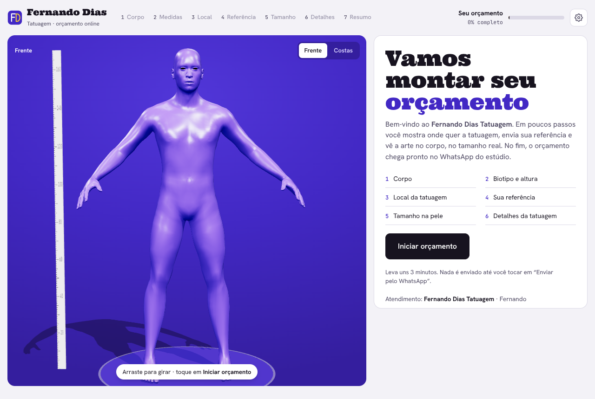
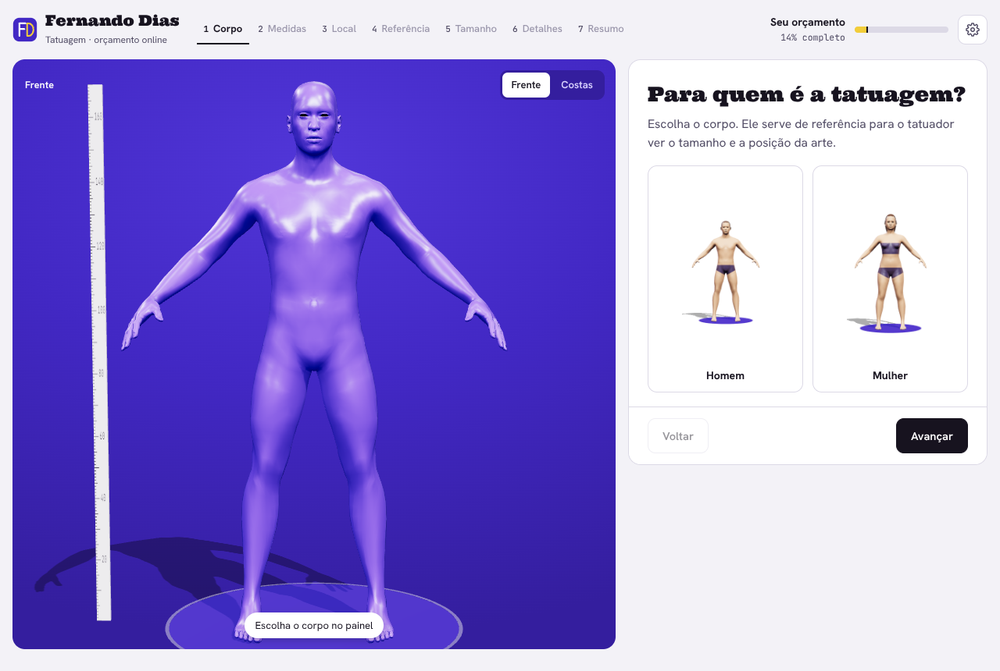
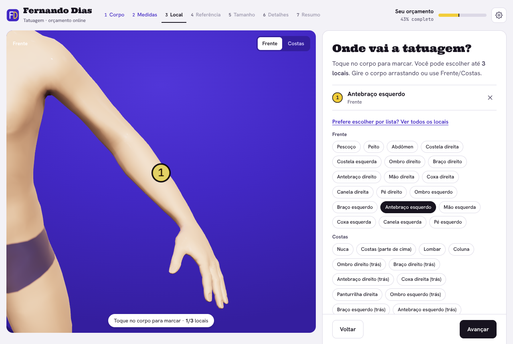
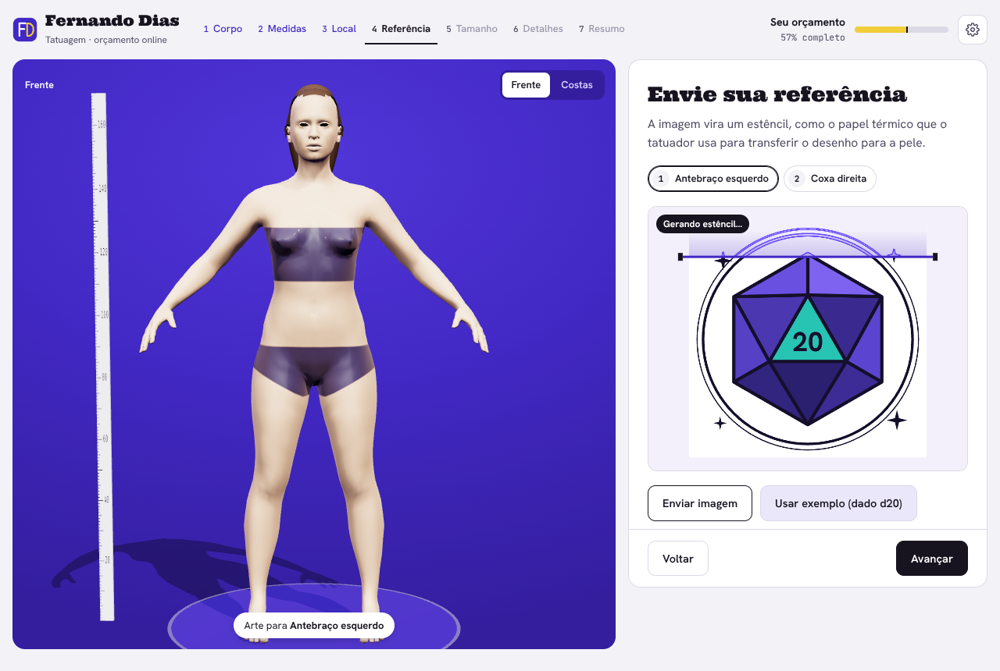
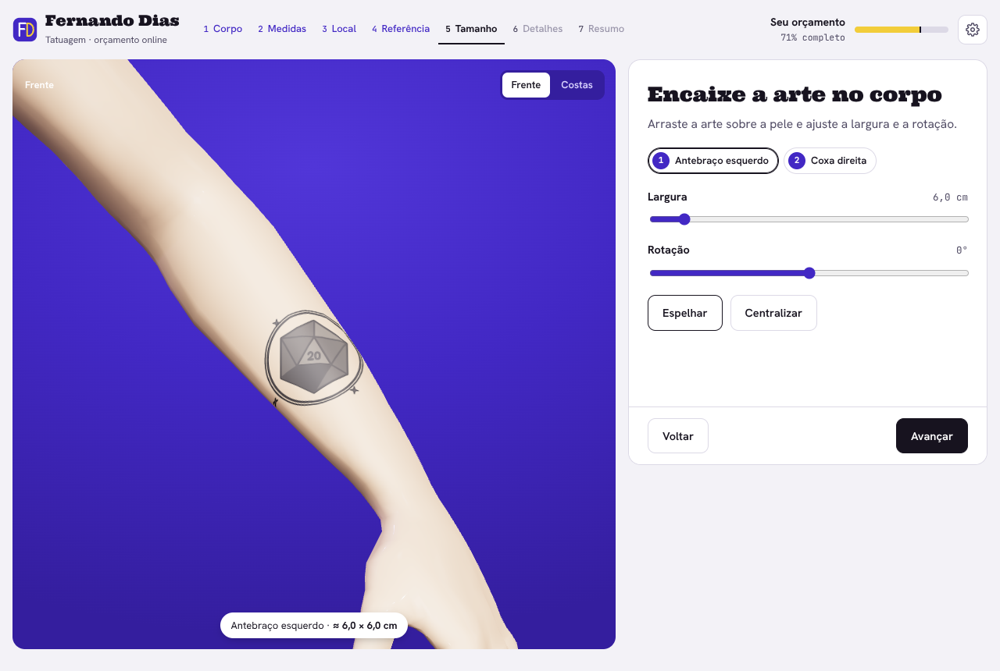
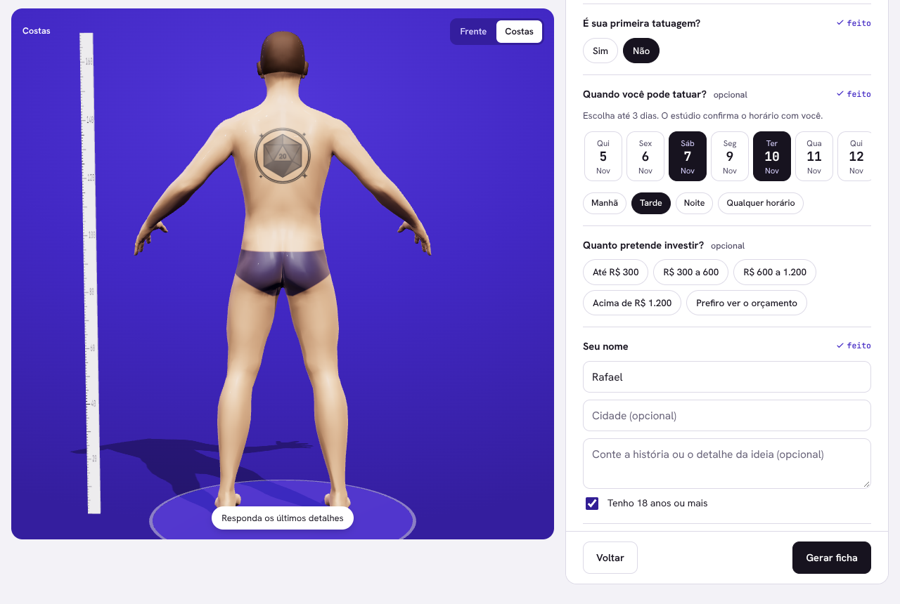
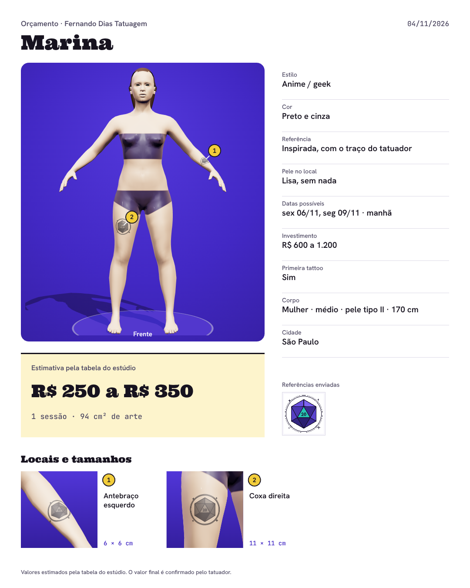

# Tattoo quote flow

A proof of concept by Fernando Dias.

Getting a tattoo quote usually means a long WhatsApp thread. Where on the body? How big? Color or black and grey? Send me a reference. Which days work for you? Clients rarely know the size in centimeters, and artists end up asking the same questions over and over.

This POC turns that conversation into a short, visual flow. The client picks a 3D body, taps where the tattoo goes, uploads a reference, sees it on the skin at real scale and picks a few days that work. The studio gets everything in one summary, ready to price and book.

[Open the live demo](https://fdias.github.io/POCTatto/)



The demo is in Portuguese because it was built for a Brazilian studio. The studio name, "Fernando Dias Tatuagem", is a placeholder.

## How it works

1. Body: the client chooses a male or female body.
2. Measurements: build, skin tone (Fitzpatrick scale) and height. Height sets the scale of the body, so every measurement afterwards is in real centimeters.
3. Placement: the client rotates the body and taps where the tattoo goes, front or back, up to three spots. The camera zooms in on each one. There's also a plain list for anyone who'd rather not tap.
4. Reference: the uploaded image turns into a stencil, the same kind of transfer sheet artists use. The client chooses between line only, line with shading, or the original colors.
5. Size: the art is projected onto the skin and follows the curve of the arm, back or leg. The client drags it into place and adjusts width and rotation.
6. Details: style, color, how closely to follow the reference, skin condition (scars, cover-up), first tattoo or not, name and age confirmation. The client can also pick up to three days and a time of day from a small calendar, and share a budget range.
7. Summary: an image with the body marked, a close-up of each spot with its size, the original reference and a price and session estimate.

<p align="center">
  
  
</p>
<p align="center">
  
  
</p>
<p align="center">
  
  
</p>

## What the studio gets

A WhatsApp message with the spots, sizes, answers and preferred days already written out, plus the summary image and the full-resolution reference. On a phone, the share button sends text and images together. On a desktop, WhatsApp opens with the text and the client attaches the summary.

The gear icon at the top is the studio's settings: studio name, WhatsApp number and the price table behind the estimate (minimum price, price per cm² for black and grey and for color, and how many cm² fit in one session).

## How it came together

It started with a tattoo studio's website. The site looked good, but booking still meant the same back-and-forth in WhatsApp. The question became: what if the quote itself were the nice part?

The first version leaned hard into games, with levels, points and a "mission". It was fun for about a minute. Talking it through, it was clear that someone getting a tattoo doesn't want a game, they want to feel understood and get a price. So the game layer went away. What stayed were the parts that make it feel alive: turning the body, the zoom when you tap a spot, the reference turning into a stencil.

The body went through three versions. A flat 2D figure made it hard to read size. A simple 3D mannequin was better, but looked cheap. The current one uses a real human mesh, so a 10 cm piece on a forearm actually looks like 10 cm on a forearm. That turned out to be the core of the idea: if the client can see the size, the first message to the studio already has the right number in it.

The questions were cut down by thinking like the artist. Each one had to change the price or the plan, or it went. Health questions were dropped on purpose. They belong to the consent form on the day of the session, not to a quote.

The look comes from the thermal stencil paper on every artist's desk: the violet carbon, the white sheet, the yellow backing tissue and black ink.

## Under the hood

It's a static site that runs entirely in the browser.

- The 3D body is the [MakeHuman](http://www.makehumancommunity.org/) base mesh, released as CC0, shaped with MakeHuman's own gender, muscle and weight targets. All eight variations (two bodies, four builds) are precomputed into a single 876 KB file in `models/`.
- The scene runs on [Three.js](https://threejs.org/). Tattoos are projected with `DecalGeometry`, limited to the body part the client picked, so a forearm piece never spills onto the torso.
- The stencil comes from the client's own image through edge detection and posterized shading on a `<canvas>`. The image never leaves the device.
- The summary is drawn on a `<canvas>` and exported as a 1080 × 1350 PNG.
- Three.js 0.160 is vendored in `vendor/`, so nothing loads from a CDN.

## Use it

The code is MIT licensed, so you can fork it, rename the studio in the settings and point it at your own WhatsApp number. Three.js keeps its own MIT license and the MakeHuman data stays CC0.

To run it locally you need a small server, since Three.js loads as an ES module:

```bash
python3 -m http.server 8000
```

Then open `http://localhost:8000`.

## Where it could go next

- Real availability: read the studio's calendar so clients only see free days, and take a deposit to hold the slot.
- Send the summary straight to the studio through the WhatsApp Business API.
- A studio dashboard with incoming requests.
- Background removal for references, in the browser.
- More body adjustments and better hair.

## About me

I'm Fernando Dias. I like taking a messy, everyday problem and turning it into something people actually enjoy using, with technology, a bit of creativity and a strong focus on the product.

If you have a problem like this, or just want to talk about an idea, write to me at [fernandodiassilvabr@gmail.com](mailto:fernandodiassilvabr@gmail.com).

If this was useful or gave you an idea, a star on the repo helps other people find it.
